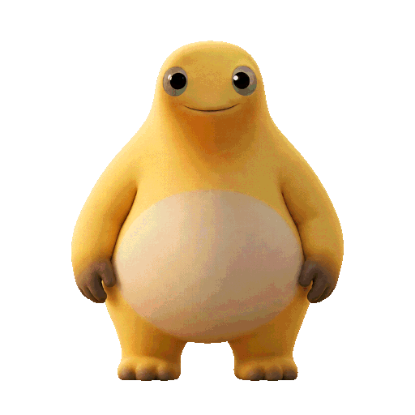

# 奶龙桌宠

Windows x64 便携桌宠，透明背景、全身角色，包含待机呼吸、眨眼、挥手、歪头、摸头和收手护肚。以 `assets/reference/original/original.gif` 为造型和摸头动作主参考，原文件保留。



## 项目目录

```text
Nailong.slnx          解决方案入口（包含程序、测试和素材工具）
src/                 WPF 桌面程序与核心交互逻辑
tests/               行为测试
tools/               素材编译与 GIF 导出工具
scripts/             构建、测试、打包与素材验证脚本
assets/animations/   随程序分发的动画帧及清单
assets/reference/    原始参考、姿势稿、生成提示词与动作预览
docs/                开发进度与历史记录
```

`.tools/`（本地 SDK 与依赖缓存）、`artifacts/`（生成预览和验证报告）、`dist/`（成品与压缩包）及各项目的 `bin/`、`obj/` 保留在本地，不提交到 Git。开发记录见 [docs/PROGRESS.md](docs/PROGRESS.md)。

## 使用

解压完整便携包，双击 `Nailong.exe`，保留旁边的 `assets` 文件夹。无需另外安装 .NET、Python 或 Node。

- 单击头部：伸手摸头 → 眼神变冷 → 向画面右侧转身 → 双手收到肚腹前 → 侧身停留 → 放手、回正。174 帧 / 30 fps / 5.8 秒。前 0.3 秒为伸手，接着保留原 GIF 约 4.7 秒反应，最后 0.8 秒回正。
- 单击白肚皮：双手从身体两侧抬起、向肚子前方收拢，贴腹停留，再放手回到待机。78 帧 / 30 fps / 2.6 秒；约 1 秒收拢、0.7 秒停留、0.9 秒放手。
- 同一摸头或护肚动作中重复点击对应区域继续当前播放，不重置、不排队。单击手臂或其他身体区域挥手；按住头部或身体拖动位置，松开不会误触发。
- 右键：播放动作、开关自动小动作、调整大小、切换置顶、隐藏或退出。
- 托盘：右键显示、隐藏、退出，双击恢复。关闭窗口或 Alt+F4 隐藏到托盘。
- 自动模式：待机呼吸，每隔约 3–7 秒眨眼、15–30 秒歪头。手动动作结束后回到待机。
- 动作切换采用约 140 毫秒短过渡，摸头手部不会成为鼠标交互区域。

设置保存至 `%LOCALAPPDATA%\NailongDesktopPet\settings.json`。重复启动不会创建第二只；屏幕布局变化时会移回可见工作区。

## 校准与素材

`assets/reference/calibrated/model-sheet.png` 和拆出的 `front.png`、`side-down.png`、`side-hold.png` 是统一造型：饱满肚腹、随体积弯曲的白肚皮、短圆微突嘴部、连贯头颈和肩背轮廓。侧身使用半垂冷眼、双手向肚腹前收拢。原 GIF 未展示的腿脚为同风格补画，不能保证全身逐像素一致；中间帧采用姿态配准插值，非原电影的三维模型重渲染。

`turn-sheet.png`、`actions-sheet.png`、`wave-sheet.png` 为本轮内置 imagegen 生成素材，实际提示词保存在同目录 `prompts.json`。旧 `assets/reference/*-sheet.png`、`pet/eyes-closed.png` 和旧提示词仅作为历史参考存档，当前编译器不使用它们。

运行时共 284 张 512×512 透明 PNG：基础四动作 32 帧、摸头 174 帧、收手护肚 78 帧。眨眼和挥手只替换移动区域，歪头使用头颈变形，均共用校准正面体型。摸头通过轮廓和面部、手位、脚部对应点配准，再作局部光流修正；允许身体和双脚随转身变化。收手护肚沿用确认的正面关键姿势，通过手掌与手指对应点配准和局部光流补帧，每帧保留一张配准后的手掌表面以减少叠影，保留校准正脸和脚部。角色尺度为 420 像素，脚底约在画布 y=470，首尾帧与待机底图一致。

预览：

- `assets/reference/belly-click/收手护肚.gif`：收手、贴腹停留、放手，2.6 秒。
- `artifacts/belly/contact-sheet.png`：护肚动作的运行时关键帧。
- `artifacts/belly/continuity-validation.json`：78 帧的连续性记录。
- `assets/reference/belly-click/production-prompt-v1.txt`：内置 imagegen 透明姿势素材提示词；最初确认稿为同目录 `keyframes-v1.png`。
- `assets/reference/pet/摸头-连贯全身.gif`：174 帧，GIF 以 30/40 毫秒交替延时近似 30 fps，总长 5.8 秒；程序使用精确 30 fps PNG 时间线。
- `artifacts/pet/original-comparison.png`：正面、开始转身、收手、侧身停留与原帧比较。
- `artifacts/pet/continuous-contact-sheet.png`：摸头与回正关键帧。
- `artifacts/animation-contact-sheet.png`：基础动作。
- `artifacts/pet/continuity-validation.json`：174 帧锚点、帧间差异、源帧映射和动作阶段。
- `artifacts/published-smoke/smoke-test.json`：发布版真实窗口与播放验证。

旧的 `摸头-透明背景.gif` 是半身原帧抠图存档，不再用于桌宠。

## 源码与构建

C# / .NET 10 / WPF，运行完全离线。`src` 为程序源码，`tests` 为行为测试，`tools/AssetCompiler` 为素材编译器。OpenCV 仅用于离线素材编译；运行桌宠不需要。

```powershell
powershell -ExecutionPolicy Bypass -File .\scripts\build.ps1
powershell -ExecutionPolicy Bypass -File .\scripts\test.ps1
powershell -ExecutionPolicy Bypass -File .\scripts\package.ps1
```

构建环境为 Windows x64，需要 .NET 10.0.403 或更新的 10.0 SDK。克隆仓库后需自行安装 SDK；脚本优先使用本地 `.tools/dotnet`，不存在时使用系统 `dotnet`，SDK 和编译缓存均不随仓库或源码包分发。首次还原依赖可能需联网。成品在 `dist/Nailong`，便携包和源码素材包在 `dist`。请按上面顺序先构建，再执行发布版窗口测试和打包；默认构建会生成 `artifacts/` 中的预览与连续性记录。重新生成原始半身抠图请单独运行 `tools/PetMatte` 默认模式；当前全身 GIF 用 `--export-continuous`。

可选的独立素材检查需 Python、Pillow 和 NumPy，在默认构建后运行：

```powershell
python .\scripts\validate-assets.py
```

`assets/animations/animations.json` 声明 `id`、`frames`、`fps`、`loop`，帧路径相对于清单目录。`idle` 循环，其他五个动作单次播放。多显示器和混合缩放体验仍需在相应硬件环境中验证。
